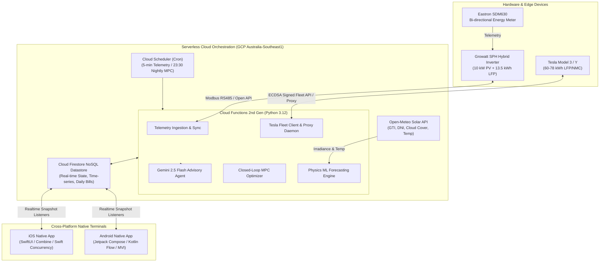
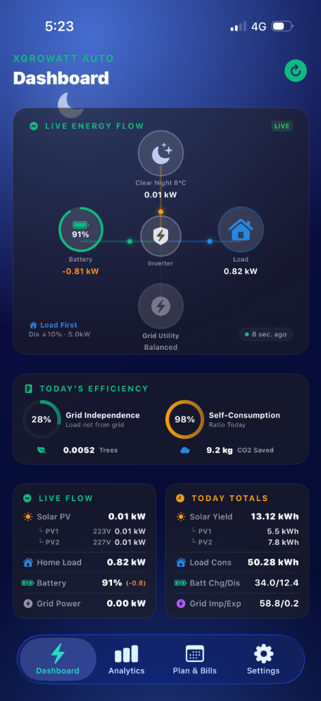
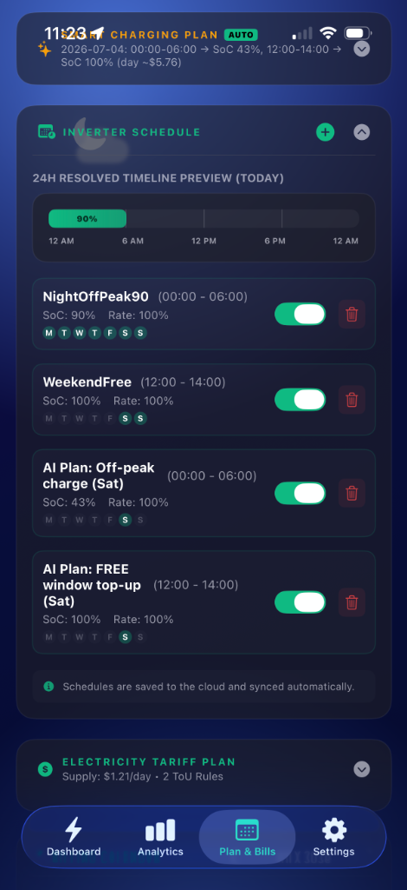
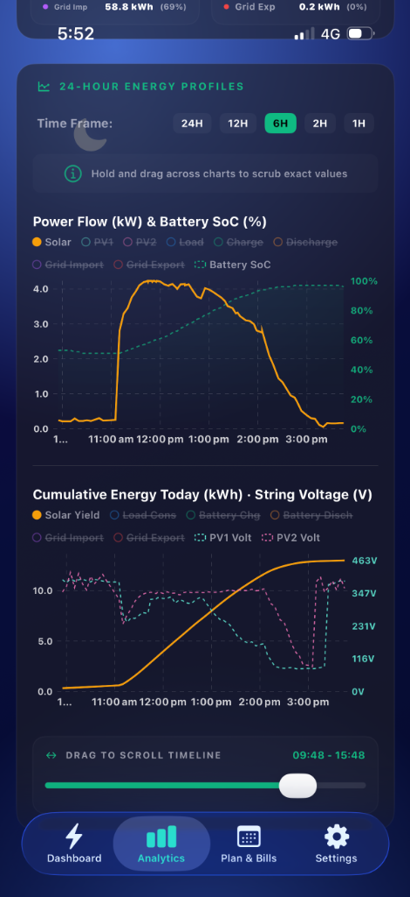
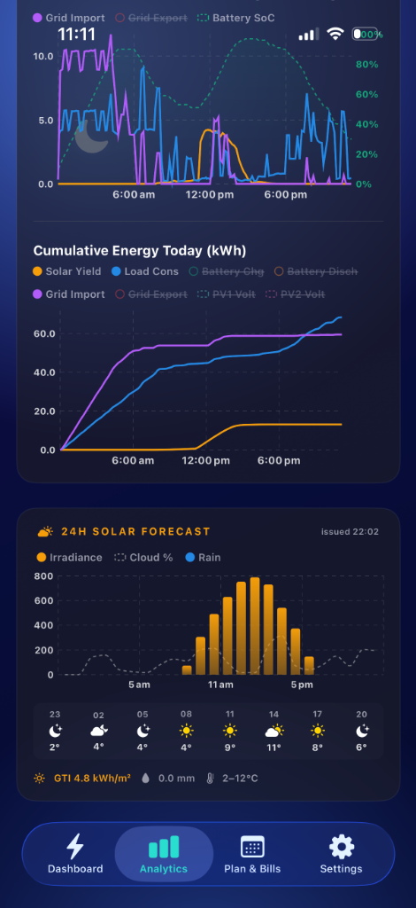
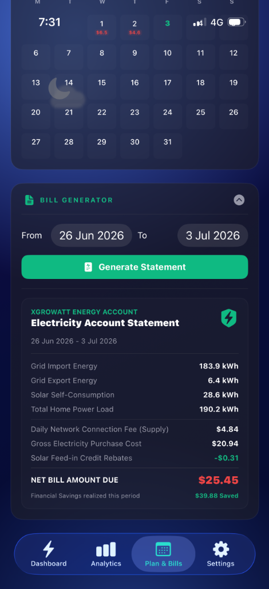

# XGrowatt: Autonomous Residential Microgrid & Solar-Battery Management System

[](LICENSE)
[](https://www.python.org/)
[](https://cloud.google.com/functions)
[](https://firebase.google.com/)
[](https://developer.apple.com/xcode/swiftui/)
[](https://developer.android.com/jetpack/compose)
[](https://deepmind.google/technologies/gemini/)

> **An autonomous, production-grade microgrid energy management system** designed for deregulated electricity markets (e.g. Australia's NEM). Combines physics-informed solar machine learning, closed-loop Model Predictive Control (MPC), reverse-engineered hybrid inverter hardware registers, and Tesla vehicle telematics to eliminate peak grid consumption, absorb surplus solar, and preserve LFP battery health.

---

## ⚡ 1. Product Insight & The Economic Arbitrage Paradox

In modern deregulated electricity grids (such as Australia's National Electricity Market), residential consumers face a severe economic paradox:

```
Electricity Price ($/kWh)
  $0.45 |                      /-- Peak Surge (15:00 - 21:00): 38¢ - 45¢
        |                     /
  $0.20 |  ------------------/    Off-Peak Baseline (00:00 - 06:00): 18¢ - 22¢
        | /
  $0.02 |/    Feed-in Tariff (FiT) Collapse (Solar Noon): 2¢ - 3¢ (or Negative)
        +--------------------------------------------------------------------> Time
```

1. **Feed-in Tariff (FiT) Collapse**: Solar export credits have plummeted from historical subsidies (> 60¢/kWh) to 2¢–3¢/kWh. Exporting solar energy to the grid yields virtually zero return.
2. **Peak Grid Import Inflation**: Evening peak electricity rates have skyrocketed past 38¢–45¢/kWh.
3. **The EV Load Challenge**: Adding an Electric Vehicle (60–80 kWh battery, 7 kW charging rate) quadruples typical household consumption, overwhelming standard 10–13.5 kWh residential battery storage.
4. **Failure of Static OEM Inverter Timers**: Factory inverter firmware relies on rigid on/off clocks that cannot account for incoming weather fronts, dynamic weekend free-power windows, or vehicle battery states.

### The Solution: Continuous Microgrid Optimization
XGrowatt transforms the household into an intelligent, autonomous microgrid:
- **EV Solar Sponge Protocol**: On high-solar days, the system discharges the home battery into the EV overnight (00:00–06:00) down to a precise floor, emptying the home battery so it can absorb 100% of tomorrow's solar generation at zero marginal cost.
- **Negative & Free Power Capture**: Automatically exploits retail free-electricity windows (e.g., weekend 12:00–14:00 $0.00/kWh windows) to charge the home battery and balance cells at maximum inverter capacity (5.0 kW).
- **Zero Peak Grid Purchase**: Guarantees that household baseload, cooking, heating, and cooling are powered entirely from stored solar, keeping peak grid imports strictly at **0.0 kW**.

---

## 🏛️ 2. End-to-End System Architecture



---

## 🧠 3. Key Technical Innovations

### 3.1 Physics-Informed Solar ML (Non-Harmonic Diurnal Modeling)
* **The Harmonic Sign-Flip Trap**: Standard time-series cyclical encodings like $\cos\left(\frac{2\pi \cdot t}{24}\right)$ reach $-1.0$ at midday ($12:00$). Linear and ridge regressions fit positive weights that inadvertently **subtract solar power at peak noon**.
* **XGrowatt's Solar Height Proxy**: We formulate a non-negative geometric proxy $h_{\text{sun}}(t)$:
  $$h_{\text{sun}}(t) = \max\left(0, \sin\left(\pi \frac{t - 6}{12}\right)\right)$$
  Multiplying Global Tilted Irradiance ($\text{GTI}$) by $h_{\text{sun}}(t)$ produces a strictly non-negative interaction feature that correctly peaks at midday and is naturally zero overnight.
* **Dual-Quantile Loss ($P_{50}$ / $P_{20}$)**: Combines expected economic yield ($P_{50}$) with an asymmetric Pinball loss quantile regressor ($P_{20}$) to establish a conservative generation floor for rainy and overcast days.

### 3.2 Closed-Loop Model Predictive Control (MPC) with Self-Damping Feedback
* **Nightly 23:30 Optimization**: Formulates tomorrow's net energy deficit:
  $$\Delta E_{\text{deficit}} = \sum_{t \in \text{Day}} \text{Load}(t) - \sum_{t \in \text{Day}} \text{Solar}_{\text{effective}}(t)$$
* **Bisection Target SoC Solver**: Solves for the minimal overnight off-peak grid pre-charge required to bridge the deficit, capping standard charging at 90% for battery longevity.
* **Self-Damping Residual Feedback**: Continuously scales predictions using a 14-day rolling performance ratio $\gamma$:
  $$\gamma = \text{clamp}\left(0.75, 1.35, \frac{\sum_{14\text{d}} \text{Actual Solar Generation}}{\sum_{14\text{d}} \text{Raw Pre-Correction Forecast}}\right)$$
  *Crucially evaluated against raw, uncorrected forecasts to avoid the recursive feedback oscillations that plague standard adaptive loops.*

### 3.3 The "EV Solar Sponge" Protocol
When tomorrow's solar forecast exceeds household storage capacity:
1. Inverter is locked in **Load First** mode (`priorityChoose = '0'`) with AC grid charging disabled (`acChargeEnable = '0'`).
2. Battery discharge limit register `wdisChargeSOCLowLimit2` is programmed to the target floor (e.g. `24%`).
3. The home battery discharges at full power (5.0 kW) to charge the Tesla vehicle, keeping grid imports at **0.0 kW**.
4. The moment the battery hits the floor, the system snapshots the vehicle odometer and energy counters, then issues `charge_stop` via Tesla Fleet API.
5. At 06:00 dawn, `wdisChargeSOCLowLimit2` is restored to `10%`, reserving full capacity for household morning loads.

### 3.4 LFP Battery Longevity & 3-Tier Calibration Verification
Lithium Iron Phosphate (LFP) cells feature a virtually flat voltage plateau between 20% and 90% SoC, making Coulomb counting prone to drift:
* **Daily 90% Health Ceiling**: Normal daily cycles clamp maximum target SoC to 90%, mitigating high-voltage cell stress and reducing electrolyte degradation.
* **7-Day Recalibration Cycle**: Once weekly, the system expands the weekend free absorption window to 5 hours (12:00–17:00).
* **3-Tier Verification Protocol**: To prevent false single-point calibration jumps, the calibration counter resets *only* when:
  1. Hardware BMS reports $\ge 98\%$ SoC.
  2. Physical terminal voltage enters the upper plateau ($V \ge 55.5\text{V}$, modeled SoC $\ge 91\%$).
  3. Cell balancing Constant Voltage (CV) absorption is sustained for **$\ge 60$ cumulative minutes**.
* **Dynamic Early Release**: Once verified, the inverter immediately releases the forced charge window back to `Load First`, preventing wasteful grid power consumption.

### 3.5 Reverse-Engineered Inverter Hardware Registers & EEPROM Protection
Growatt SPH hybrid inverters are managed via an 18-parameter ordered configuration array (`mix_ac_charge_time_period`). 
* **EEPROM Wear-out Prevention**: Frequent writes to microcontroller flash memory cause permanent hardware failure. XGrowatt implements an in-memory hash diff cache; writes are dispatched **only** when register values physically change.
* **Deterministic Air-Gapped Fallback**: If cloud connectivity is severed, the inverter's hardware fallback safely prioritizes household load consumption and self-consumption without violating grid export rules.

### 3.6 Pragmatic AI: Gemini 2.5 Flash Advisory Agent
Integrated Google Gemini 2.5 Flash acts as an automated microgrid operations analyst:
* Analyzes 72-hour weather projections, battery degradation telemetry, and tariff schedules.
* Generates concise, plain-English executive briefings and natural dialogue explaining charging decisions to household users.

---

## 📱 4. Cross-Platform Native Mobile Clients

The repository contains complete, production-grade native applications for both iOS and Android, featuring a unified dark-mode fintech interface:

<p align="center">
  
  
  
  
  
</p>

| Screen | Core Functionality & Architectural Value |
|:---|:---|
| **01. Live Energy Flow** | Real-time Canvas power routing vector map (Solar $\to$ Inverter $\to$ Battery $\to$ Load $\to$ Grid), live self-consumption (98%) and grid independence rates. |
| **02. AI Day-Ahead Schedule** | 24-hour resolved timeline preview, automated overnight off-peak pre-charge, and weekend free-power top-up window triggers. |
| **03. Power Flow & Voltage** | Telemetry curves showing dynamic MPPT string tracking, battery voltage plateau saturation, and real-time load spikes. |
| **04. Solar & Weather Forecast** | Open-Meteo GTI irradiance modeling, cloud opacity attenuation, and temperature overlay for predictive MPC planning. |
| **05. Automated Electricity Bill** | Real-time financial reconciliation, net bill calculation, and cumulative arbitrage savings ($39.88/week) under dynamic retail tariffs. |

### iOS Native App (`XGrowatt/`)
* **Technology**: Pure Swift, SwiftUI, Combine, Swift Concurrency (`async`/`await`).
* **Visual Architecture**:
  * Custom `Canvas`-rendered animated **Energy Flow Diagram** visualizing real-time power transfers (Solar $\to$ Inverter $\to$ Battery $\to$ Home $\to$ Grid $\to$ EV).
  * Real-time Firestore snapshot listeners updating UI State within 100ms of hardware telemetry changes.
  * Interactive battery health charts and dynamic tariff calculators.

### Android Native App (`XGrowattAndroid/app/`)
* **Technology**: Modern Kotlin, Jetpack Compose, Material 3, Navigation 3, StateFlow / Flow MVI architecture.
* **Visual Architecture**:
  * Pull-to-refresh real-time sync with Google Cloud Functions backend.
  * Embedded Google Maps SDK integration for dynamic EV location and solar irradiation tracking.
  * Dark mode design adhering to modern Android system styling.

---

## 📂 5. Repository Structure

```
.
├── functions/                    # Serverless Cloud Functions (Python 3.12)
│   ├── main.py                   # Master orchestration, MPC optimizer, sync workers & Gemini agent
│   ├── tesla_fleet.py            # Tesla Fleet API client with anti-vampire drain sleep protection
│   ├── tesla_proxy_data.py       # Tesla HTTP proxy client stub & binary loader
│   ├── backfill_weather.py       # Historical Open-Meteo ERA5 weather backfill utility
│   ├── requirements.txt          # Python dependencies (firebase-admin, scikit-learn, requests)
│   └── test_*.py                 # Unit and integration test suites
│
├── ml/                           # Solar ML Training & Pipeline
│   ├── train_pv_model.py         # Physics-informed Bayesian Ridge / Ridge regression training
│   ├── export_dataset.py         # Firestore telemetry & weather feature dataset exporter
│   ├── auto_retrain.py           # Scheduled automated model retraining pipeline
│   └── check_firestore.py        # Database schema and telemetry validation utility
│
├── XGrowatt/                     # Native iOS Application (SwiftUI)
│   ├── XGrowatt/
│   │   ├── ContentView.swift     # Main dashboard, telemetry cards, and controls
│   │   ├── EnergyFlowView.swift  # Animated Canvas vector power flow visualization
│   │   ├── FirebaseManager.swift # Firestore realtime snapshot synchronizer
│   │   ├── MascotAiManager.swift # Gemini AI dialogue integration
│   │   └── GoogleService-Info.plist.example # Firebase client config template
│   └── XGrowatt.xcodeproj        # Xcode project file
│
├── XGrowattAndroid/              # Native Android Application (Jetpack Compose)
│   ├── app/                      # Main phone application module
│   │   ├── src/main/java/...     # Compose screens, ViewModels, repository & data layers
│   │   ├── build.gradle.kts      # App-level dependencies & Gradle build script
│   │   └── google-services.json.example # Firebase client config template
│   ├── build.gradle.kts          # Top-level Gradle configuration
│   └── settings.gradle.kts       # Gradle module settings
│
├── docs/                         # In-Depth Engineering Documentation
│   ├── ARCHITECTURE.md           # Full mathematical formulation, MPC solver & state machines
│   ├── HARDWARE_REGISTERS.md     # Growatt SPH 18-parameter array & Modbus register dictionary
│   └── FIREBASE_DEBUG_GUIDE.md   # Firestore query patterns, collection conventions & troubleshooting
│
├── firebase.json                 # Firebase Cloud Functions & Hosting deployment manifest
├── firestore.rules               # Firestore security and role-based access rules
├── firestore.indexes.json        # Composite database indexes
└── .env.example                  # Environment configuration template
```

---

## 🚀 6. Quickstart & Deployment Guide

### Prerequisites
- **Python 3.12+**
- **Node.js 20+** & **Firebase CLI** (`npm install -g firebase-tools`)
- **Xcode 15+** (for iOS build)
- **Android Studio Ladybug / Meerkat+** with JDK 17 (for Android build)
- A Google Cloud Project with Cloud Functions (2nd Gen) and Cloud Firestore enabled.

### 1. Cloud Backend Setup
```bash
# 1. Clone the repository
git clone https://github.com/sungchao/xgrowatt.git
cd XGrowatt

# 2. Configure environment credentials
cp .env.example .env
# Fill in your GEMINI_API_KEY, GROWATT credentials, and TESLA credentials

# 3. Setup Python environment
cd functions
python3 -m venv venv
source venv/bin/activate
pip install -r requirements.txt

# 4. Deploy to Firebase / Google Cloud
firebase login
firebase use --add your-firebase-project-id
firebase deploy --only functions,firestore:rules,firestore:indexes
```

### 2. Client Setup
- **iOS**:
  1. Download your `GoogleService-Info.plist` from Firebase Console.
  2. Copy to `XGrowatt/XGrowatt/GoogleService-Info.plist`.
  3. Open `XGrowatt/XGrowatt.xcodeproj` in Xcode and run on iPhone / Simulator.
- **Android**:
  1. Download your `google-services.json` from Firebase Console.
  2. Copy to `XGrowattAndroid/app/google-services.json`.
  3. Open `XGrowattAndroid/` in Android Studio and run on device / emulator.

---

## 📜 7. Engineering Documentation
For full mathematical proofs, register maps, and operational details, refer to:
- [System Architecture & Mathematical Specifications](docs/ARCHITECTURE.md)
- [Growatt SPH Hardware Register Mapping Guide](docs/HARDWARE_REGISTERS.md)
- [Firebase & Cloud Functions Debugging Guide](docs/FIREBASE_DEBUG_GUIDE.md)

---

## 📄 8. License

Licensed under the **Apache License, Version 2.0**. See the [LICENSE](LICENSE) file for terms.
