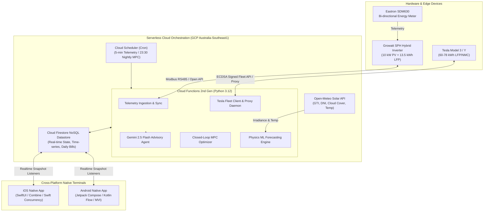
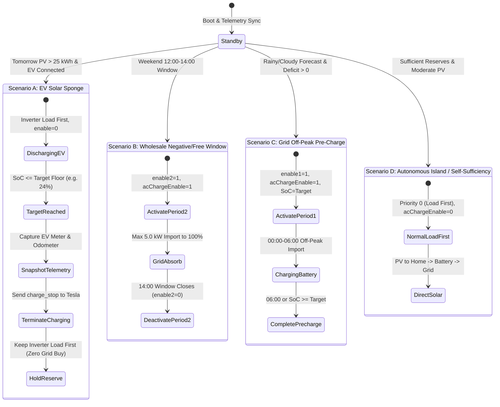

# System Architecture & Technical Specifications

## 1. Executive Summary & Market Context

The transition of residential power systems in deregulated electricity markets—most acutely demonstrated in Australia's National Electricity Market (NEM)—presents a classic **energy arbitrage paradox**:

1. **Feed-in Tariff (FiT) Collapse**: Solar export compensation has dropped precipitously from historical subsidies (> 60¢/kWh) down to nominal wholesale rates (2¢–3¢/kWh), occasionally dipping into negative pricing territory during peak solar noon.
2. **Surging Peak Energy Rates**: Evening peak grid import prices have climbed beyond 35¢–45¢/kWh.
3. **EV Load Integration**: Electric Vehicle (EV) adoption introduces large, flexible loads (50–100 kWh battery capacities with 7–11 kW charging draws) that dwarf typical household baseloads (10–15 kWh/day).

Traditional inverter OEM scheduling employs static time-of-use (TOU) clocks that cannot anticipate cloud fronts, household load spikes, dynamic weekend free-power windows, or vehicle charging needs. 

**XGrowatt** is an autonomous, serverless microgrid management system. By combining physics-informed machine learning, closed-loop Model Predictive Control (MPC), reverse-engineered inverter hardware control, and Tesla vehicle telematics, XGrowatt minimizes grid power costs while maximizing battery longevity and solar self-consumption.

---

## 2. End-to-End System Topology



---

## 3. Physics-Informed Solar & Load Machine Learning Engine

### 3.1 The Diurnal Non-Harmonic Irradiance Model
Standard time-series libraries often introduce trigonometric harmonics like $\cos\left(\frac{2\pi \cdot t}{24}\right)$ to capture diurnal cycles. However, standard linear and ridge regression models fit positive weights to nighttime terms and negative weights during the noon window ($10:00 - 14:00$), where cosine approaches $-1.0$. This creates an unphysical artifact: **predicting negative power under intense midday sun**.

To preserve physical validity, XGrowatt uses a strictly non-negative solar elevation proxy:

$$\text{sun\_height}(t) = \max\left(0, \sin\left(\pi \frac{t - 6}{12}\right)\right), \quad t \in [0, 24)$$

By interacting Global Tilted Irradiance ($\text{GTI}$) directly with this proxy:

$$\text{Feature}_{\text{GTI\_Elev}}(t) = \text{GTI}(t) \times \text{sun\_height}(t)$$

The feature is identically zero from dusk till dawn ($18:00 - 06:00$) and peaks at solar noon ($12:00$), matching photovoltaic physics without sign inversion.

### 3.2 Dual-Quantile Optimization (Median $P_{50}$ vs Survival $P_{20}$)
Relying solely on Mean Squared Error (MSE) produces a median forecast ($P_{50}$) that leaves the microgrid exposed to sudden cloud events. To resolve this:
- **Median Forecaster ($P_{50}$)**: Fits expected economic value under standard meteorological conditions.
- **Pessimistic Floor Forecaster ($P_{20}$)**: Trained via **Pinball Loss (Quantile Regression)** at $\tau = 0.20$:

$$\mathcal{L}_{\tau}(y, \hat{y}) = \max\left(\tau(y - \hat{y}), (1 - \tau)(\hat{y} - y)\right)$$

The planner sets tomorrow's energy availability using:

$$\text{Solar}_{\text{effective}} = \max\left(P_{20}\text{ Solar Floor}, \quad P_{50}\text{ Solar} - \text{Dynamic Safety Margin}\right)$$

### 3.3 Self-Damping Closed-Loop Bias Calibration
Atmospheric conditions, module soiling, and seasonal degradation introduce persistent prediction bias. The system continuously computes a 14-day rolling performance ratio $\gamma$:

$$\gamma = \text{clamp}\left(0.75, 1.35, \frac{\sum_{d=1}^{14} \text{Actual Generation}_d}{\sum_{d=1}^{14} \text{Raw Uncorrected Forecast}_d}\right)$$

> [!IMPORTANT]
> **Stability Condition**: $\gamma$ is evaluated against **raw, pre-correction forecasts** (`pv_forecast_raw_kwh`), preventing recursive feedback loops that cause 14-day limit-cycle oscillations.

---

## 4. Closed-Loop Model Predictive Control (MPC) Solver

Nightly at 23:30 AEST, the MPC solver determines the optimal overnight battery charging target ($\text{Target SoC}$) for the 00:00–06:00 off-peak window.

### 4.1 Energy Balance Formulation
For the upcoming dispatch horizon $H = [06:00, 23:59]$:

$$\Delta E_{\text{deficit}} = \sum_{t \in H} \text{Load}(t) - \sum_{t \in H} \text{Solar}_{\text{effective}}(t)$$

- **Case 1: Projected Deficit ($\Delta E_{\text{deficit}} > 0$)**:
  Daytime solar is insufficient to cover daytime household usage. The system calculates the exact pre-charge energy required from the off-peak overnight grid ($18¢/\text{kWh}$) to avoid expensive evening peak imports ($38¢/\text{kWh}$):
  
  $$\text{Target SoC} = \min\left(90\%, \text{Current SoC} + \frac{\Delta E_{\text{deficit}}}{C_{\text{bat}} \cdot \eta_{\text{roundtrip}}} \times 100\right)$$

- **Case 2: Projected Surplus ($\Delta E_{\text{deficit}} \le 0$) — The EV Solar Sponge**:
  Daytime solar will saturate the home battery, leading to low-value grid exports (2¢/kWh). The system initiates **EV Solar Sponge mode**:
  1. Calculates surplus solar energy: $E_{\text{surplus}} = |\Delta E_{\text{deficit}}|$.
  2. Unlocks the home battery to discharge into the connected EV during 00:00–06:00 down to a calculated floor:
     
     $$\text{Target Floor} = \max\left(\text{Min SoC}, \text{Current SoC} - \frac{E_{\text{surplus}}}{C_{\text{bat}}} \times 100\right)$$
     
  3. Pre-emptively creates headroom in the home battery, capturing $100\%$ of tomorrow's solar generation while charging the EV at zero marginal cost.

---

## 5. Microgrid Operational State Machine



---

## 6. LFP Chemistry Longevity & Calibration Protocols

Lithium Iron Phosphate (LiFePO4 / LFP) chemistry exhibits an exceptionally flat open-circuit voltage curve between 20% and 90% SoC. This makes voltage-based State of Charge estimation susceptible to Coulomb-counting drift over extended cycling.

```
Cell Voltage (V)
  3.65 |                     /-- Full (100%)
  3.40 |  ------------------/    Flat Operating Plateau (15% - 90%)
  3.20 | /
  2.50 |/ Empty (0%)
       +---------------------------------------------
       0%                    50%                  100% SoC
```

### 6.1 Daily 90% Health Ceiling
Under ordinary operational cycles, the system clamps the maximum target SoC to **90%** (or dynamically between 62% and 80% when solar margin allows). This reduces cell mechanical expansion stress and electrolyte degradation associated with continuous high-voltage saturation.

### 6.2 3-Tier Strict Calibration Verification
Every 7 days, the system schedules a cell-balancing recalibration cycle to eliminate BMS drift:
1. Expands the weekend absorption window to 5 hours (12:00–17:00).
2. Requires all three verification conditions to certify calibration and reset `days_since_last_calibration = 0`:
   - **Hardware BMS Reported SoC**: $\text{SoC} \ge 98\%$.
   - **Physics AI Model Cross-Check**: Terminal voltage indicates upper plateau entry ($V_{\text{pack}} \ge 55.5\text{V}$, modeled SoC $\ge 91\%$), preventing false triggers from single-point telemetry glitches.
   - **Constant Voltage (CV) Dwell Time**: Pack must sustain high-voltage balancing for **$\ge 60$ cumulative minutes** ($\ge 12$ consecutive 5-minute sampling intervals).

### 6.3 Dynamic Early Release
The moment the 3-tier calibration verification passes, the controller automatically releases the forced charge state and transitions the inverter back to `Load First` mode. This ensures that surplus solar powers the home directly rather than idling in high-voltage saturation.

---

## 7. Reliability, Hardware Safety & Edge Fault-Tolerance

### 7.1 EEPROM Write Endurance Preservation
Inverter microcontrollers use non-volatile EEPROM/NOR flash to persist operational registers. Indiscriminate 5-minute writes would exhaust flash endurance within 1–2 years.
- **Idempotent Register Diffing**: The cloud engine computes an MD5 checksum of the target 18-parameter array against the hardware read-back cache. If the register state has not changed, the physical write request is bypassed.

### 7.2 EV Anti-Vampire Drain Architecture
Tesla vehicles enter a low-power deep sleep mode to conserve 12V battery health and high-voltage energy. Frequent API polling can wake the vehicle, burning 200–300W in computer overhead:
- The system checks vehicle status via the lightweight `get_vehicles()` endpoint.
- If the vehicle is reported as `asleep`, the engine reuses the last cached telemetry snapshot and exits immediately without sending a `wake_up` command.
- Wake commands are dispatched only when an active, scheduled charging window begins.

### 7.3 Air-Gapped Inverter Fallback
If cloud connectivity or network access is interrupted:
- The Growatt SPH inverter operates autonomously under its baseline hardware profile (`Load First`).
- Hardware registers default to non-destructive self-consumption: local solar covers household loads first, charges the battery second, and exports surplus third.
- Grid imports are physically restricted by hardware registers unless an active schedule is affirmed by the cloud engine.
